# 에이톰-AX · Atom-AX

**AX 기반 공공주택 안전·유지관리 플랫폼 — 기술 보고서 · AX-based Public Housing Safety & Maintenance Platform — Technical Report**

| 항목 · Item | 한국어 | English |
|---|---|---|
| 과제명 · Project | AX 기반 공공임대주택 시설물 안전·유지관리 최적화 및 지능형 행정 자동화 솔루션 상용화 | Commercialising AX-based safety/maintenance optimisation and intelligent admin automation for public rental housing |
| 사업 · Program | 국토교통부 AX-SPRINT (AI 응용제품 신속 상용화 지원사업) — 국토·교통분야 | MOLIT AX-SPRINT (fast commercialisation of AI products) — land & transport track |
| 주관 · Lead | (주)에이톰엔지니어링 | Atom Engineering Co., Ltd. |
| 참여 · Partners | 세종대학교 산학협력단 × 한국화재보험협회(방재시험연구원) | Sejong University × Korea Fire Protection Association (KFPA) |
| 위탁 · Subcontract | (사)첨단기술안전점검협회 (HSIA) | High-tech Safety Inspection Association (HSIA) |
| 자문 · Advisory | 한국건설기술연구원 (KICT) × 법무법인 수호 | KICT × Suho Law Firm |
| 수요처 · Demand sites | 서울주택도시공사 (SH) × 경상북도개발공사 (GBDC) | Seoul Housing (SH) × Gyeongbuk Development Corp. (GBDC) |
| 버전 · Version | v2.4 (2026-11-19) · TRL 8 수준 현장실증 프로토타입 | v2.4 (2026-11-19) · TRL 8 field-demo prototype |
| 라이브 데모 · Live demo | https://ax-sprint-prototype.onrender.com/ | https://ax-sprint-prototype.onrender.com/ |

---

## 0. 배경 · 왜 · 용어 · Background · Why · Glossary

| | 한국어 | English |
|---|---|---|
| **배경 · 현황** | 9개 페이지 Streamlit 앱과 9개 scikit-learn 파이프라인이 Render 에 배포돼 있다. 데이터는 전부 seed 고정 합성 데이터다. | A 9-page Streamlit app and 9 scikit-learn pipelines run on Render. All data is seeded synthetic data. |
| **왜 하는가** | AX-SPRINT 사업계획서의 기능(비전 AI · IoT · RPA · XAI)을 수요처가 화면으로 확인하게 한다. 실데이터 연동 전 설계 검증용이다. | It lets demand sites see the AX-SPRINT plan's features (vision AI, IoT, RPA, XAI) on screen. It validates the design before real-data integration. |
| **구현 범위** | 이 저장소에서 실제로 돌아가는 모형은 §7.1 「프로토타입 구현」 열이다. Y-MaskNet · KoBERT · LSTM 등은 목표 설계이며 아직 코드에 없다. | Models that actually run in this repo are in §7.1 "Prototype" column. Y-MaskNet, KoBERT, LSTM etc. are target designs not yet in code. |

| 용어 · Term | 정의 (KR) | Definition (EN) |
|---|---|---|
| AX | AI Transformation. AI 로 업무 방식을 바꾸는 전환 | AI Transformation: re-shaping work processes with AI |
| TRL | Technology Readiness Level. 기술 성숙도 1~9 단계 | Technology Readiness Level, maturity scale 1–9 |
| RPA | Robotic Process Automation. 규칙 기반 반복 행정 업무 자동화 | Robotic Process Automation: rule-based automation of repetitive admin work |
| XAI | Explainable AI. 모형 판정 근거를 보여 주는 AI | Explainable AI: AI that shows the reasons behind a prediction |
| SHAP | SHapley Additive exPlanations. feature 별 예측 기여도 분해 방법 | SHapley Additive exPlanations: per-feature contribution decomposition |
| IoT | Internet of Things. 온도 · 습도 · 진동 등 현장 센서망 | Internet of Things: on-site sensor network (temperature, humidity, vibration …) |
| Digital Twin | 실제 건물을 실시간 데이터로 복제한 가상 모형 | Virtual replica of a building driven by live data |
| FMS | 국토안전관리원 시설물통합정보관리시스템 (KALIS-FMS) | KALIS Facility Management System |
| 세움터 · Seumteo | 국토교통부 건축행정 시스템 (건축물대장 · 설계 정보) | MOLIT building-administration system (building register, design data) |
| RF | Random Forest. 결정나무 여러 개의 다수결 앙상블 | Random Forest: majority-vote ensemble of decision trees |
| GBC · GBR | Gradient Boosting Classifier · Regressor. 오차를 순차 보정하는 나무 앙상블 | Gradient Boosting Classifier / Regressor: trees fitted sequentially on residuals |
| HGB | HistGradientBoosting. 구간화(histogram) 기반 고속 gradient boosting | Histogram-based fast gradient boosting |
| IF | Isolation Forest. 고립이 쉬운 점을 이상치로 보는 비지도 탐지 | Isolation Forest: unsupervised detector that flags easily isolated points |
| LR | Logistic Regression. 확률을 내는 선형 분류기 | Logistic Regression: linear classifier that outputs probabilities |
| TF-IDF | Term Frequency–Inverse Document Frequency. 문서 속 단어 가중치 | Term Frequency–Inverse Document Frequency word weighting |
| F1 | 정밀도와 재현율의 조화평균 | Harmonic mean of precision and recall |
| PR-AUC | Precision–Recall 곡선 아래 면적. 불균형 이상 탐지 지표 | Area under the precision–recall curve, for imbalanced detection |
| R² | 결정계수. 회귀가 설명한 분산 비율 | Coefficient of determination: share of variance explained |
| MAPE | Mean Absolute Percentage Error. 평균 절대 백분율 오차 | Mean Absolute Percentage Error |
| Walk-forward | 과거로 학습하고 바로 다음 구간으로 검증하는 시계열 검증 | Time-series validation: train on past, test on the next block |
| Calibration | 예측 확률이 실제 빈도와 맞도록 보정 | Adjusting predicted probabilities to match observed frequencies |
| Permutation importance | feature 값을 섞었을 때 성능 하락으로 잰 중요도 | Importance measured by score drop when a feature is shuffled |
| ROI | Return on Investment. 투자 대비 수익률 | Return on Investment |
| KPI | Key Performance Indicator. 핵심 성과 지표 | Key Performance Indicator |

---

## 목차 · Contents

| # | 한국어 | English |
|---|---|---|
| 1 | [시스템 개요](#1-시스템-개요--system-overview) | System overview |
| 2 | [기술 스택](#2-기술-스택--tech-stack) | Tech stack |
| 3 | [파일 구조](#3-파일-구조--file-layout) | File layout |
| 4 | [아키텍처](#4-아키텍처--architecture) | Architecture |
| 5 | [데이터 모델](#5-데이터-모델--data-model) | Data model |
| 6 | [9개 페이지](#6-9개-페이지--nine-pages) | Nine pages |
| 7 | [AI 모델](#7-ai-모델--ai-models) | AI models |
| 8 | [55개 데이터셋 파이프라인](#8-55개-데이터셋-파이프라인--55-dataset-pipeline) | 55-dataset pipeline |
| 9 | [RPA 행정 자동화](#9-rpa-행정-자동화--rpa-automation) | RPA automation |
| 10 | [KPI · 기대효과](#10-kpi--기대효과--kpis--expected-impact) | KPIs & expected impact |
| 11 | [실행 · 배포](#11-실행--배포--run--deploy) | Run & deploy |
| 12 | [컨소시엄](#12-컨소시엄--consortium) | Consortium |
| 13 | [로드맵 · 버전](#13-로드맵--버전--roadmap--versions) | Roadmap & versions |

---

## 1. 시스템 개요 · System overview

| 한국어 | English |
|---|---|
| SH 서울주택도시공사와 경상북도개발공사가 관리하는 공공임대주택 **7개 단지 2,847세대**의 안전·유지관리와 행정 업무를 AI 와 RPA 로 묶는 웹 플랫폼이다. | A web platform that combines AI and RPA for safety, maintenance and admin work across **7 complexes / 2,847 households** of public rental housing run by SH and GBDC. |
| 드론·앱으로 손상을 찾고, IoT·AI 가 사고 전에 경고하고, 민원·관리비·계약은 RPA 가 처리한다. | Drones and an app find damage, IoT and AI warn before incidents, and RPA handles complaints, fees and contracts. |

### 1.1 3대 핵심 축 · Three pillars

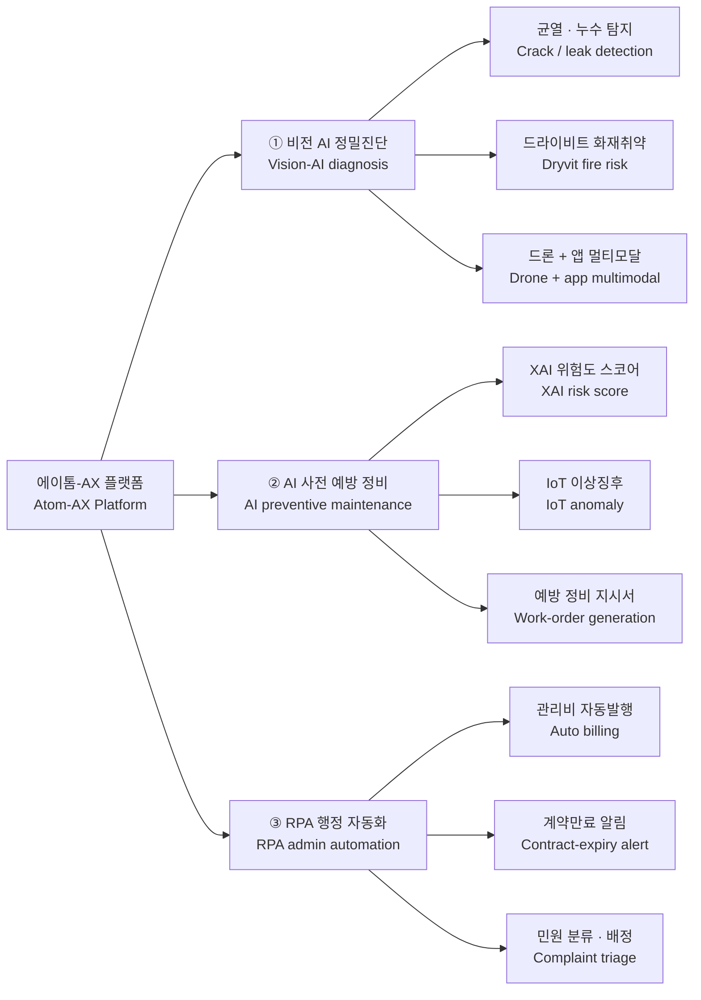

### 1.2 관리 대상 단지 · Managed complexes

| 수요처 · Site | 단지 · Complex | 준공 · Built | 세대 · Units | 유형 · Type |
|---|---|---|---|---|
| SH | 강남 매입임대 A · Gangnam purchased-rental A | 1998 | 220 | 매입임대 · Purchased rental |
| SH | 마포 영구임대 B · Mapo permanent-rental B | 2001 | 480 | 영구임대 · Permanent rental |
| SH | 노원 국민임대 C · Nowon national-rental C | 2004 | 620 | 국민임대 · National rental |
| SH | 강서 행복주택 D · Gangseo happy-housing D | 2018 | 310 | 행복주택 · Happy housing |
| SH | 서초 매입임대 E · Seocho purchased-rental E | 1996 | 185 | 매입임대 · Purchased rental |
| GBDC | 구미 영구임대 A · Gumi permanent-rental A | 2002 | 290 | 영구임대 · Permanent rental |
| GBDC | 안동 국민임대 B · Andong national-rental B | 2005 | 380 | 국민임대 · National rental |

---

## 2. 기술 스택 · Tech stack

| 레이어 · Layer | 기술 · Tech | 버전 · Ver | 한국어 용도 | English use |
|---|---|---|---|---|
| 웹 · Web | Streamlit | 1.44.0 | 대시보드 UI | Dashboard UI |
| 시각화 · Viz | Plotly | 5.24.1 | 인터랙티브 차트 | Interactive charts |
| 데이터 · Data | Pandas | 2.2.3 | DataFrame 조작·집계 | DataFrame wrangling |
| 수치 · Numeric | NumPy | 1.26.4 | 합성 데이터 · 통계 | Synthetic data, stats |
| 이미지 · Image | Pillow | 11.1.0 | 탐지 결과 그림 시뮬레이션 | Simulated detection images |
| ML | scikit-learn | 1.8.0 | 9개 파이프라인 학습·추론 | Train / infer 9 pipelines |
| 통계 · Stats | statsmodels | 0.14.4 | Plotly OLS 추세선 | Plotly OLS trendline |
| 런타임 · Runtime | Python | 3.11.9 | 실행 환경 | Runtime |

```bash
pip install -r requirements.txt
```

---

## 3. 파일 구조 · File layout

```
ax-sprint-prototype/
├── app.py              # Streamlit 앱, 9개 페이지 · Streamlit app, 9 pages
├── ai_pipeline.py      # AXPipelineEngine, 9개 scikit-learn 파이프라인 · 9 sklearn pipelines
├── main.py             # 실행 진입점 (streamlit run 래퍼) · entry point wrapper
├── requirements.txt    # 의존성 (버전 고정) · pinned dependencies
├── render.yaml         # Render 배포 Blueprint · Render deploy blueprint
├── .streamlit/config.toml  # 서버 · 테마 설정 · server & theme
├── docs/               # 공고문 · 사업계획서 PDF · call notice & plan PDFs
├── PDF/                # 사업계획서 생성 스크립트 · docx · plan generators & docx
└── PDF_NEW/            # 사업계획서 프레임워크 메모 · plan framework notes
```

---

## 4. 아키텍처 · Architecture

### 4.1 전체 구조 · End-to-end

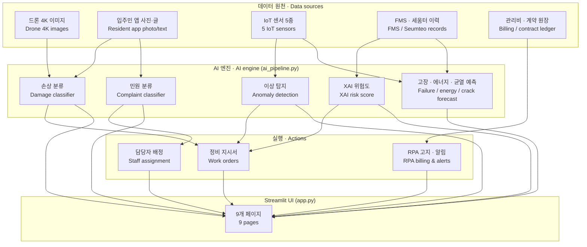

### 4.2 페이지 라우팅 · Page routing

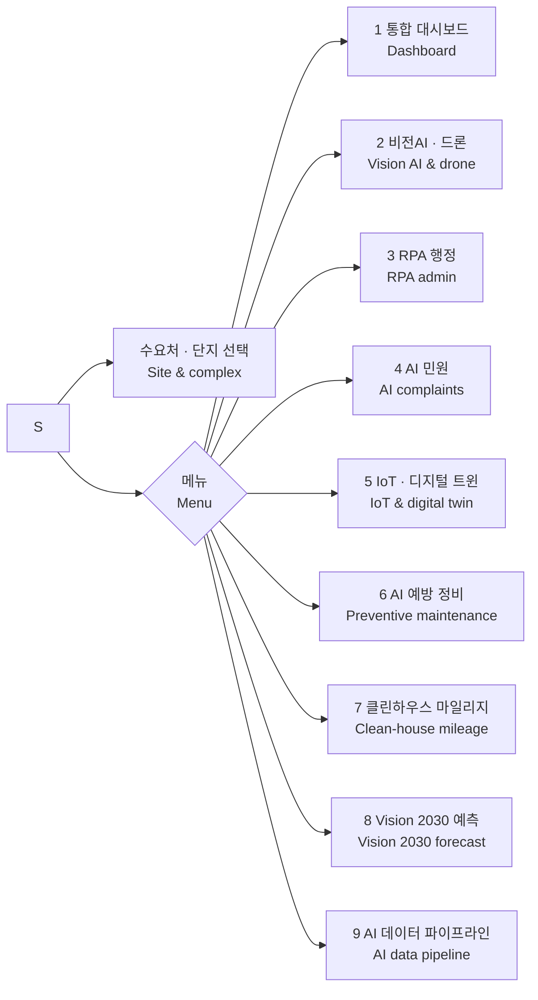

### 4.3 세션 캐시 · Session cache

| 한국어 | English |
|---|---|
| 앱이 처음 열릴 때 `make_*()` 10개가 DataFrame 을 만들고 `st.session_state` 에 넣는다. 페이지를 바꿔도 같은 데이터를 쓴다. | On first load, ten `make_*()` functions build DataFrames into `st.session_state`. Page switches reuse the same data. |
| `np.random.seed(2026)` 으로 고정해 매번 같은 값이 나온다. | `np.random.seed(2026)` fixes the values on every run. |

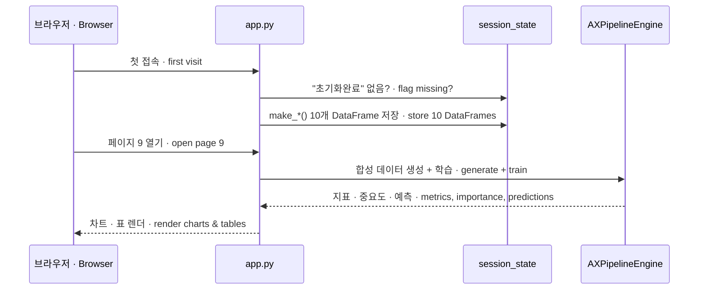

---

## 5. 데이터 모델 · Data model

### 5.1 데이터 생성 함수 · Generator functions

| 함수 · Function | 한국어 | English | 건수 · Rows |
|---|---|---|---|
| `make_iot_data()` | IoT 센서 시계열 | IoT sensor time series | 720 (30 d × 24 h) |
| `make_complaints()` | 민원 | Complaints | 80 |
| `make_inspection()` | 점검 이력 | Inspection history | 84 (7 × 12 mo) |
| `make_facilities()` | 시설물 대장 | Facility register | 7 |
| `make_damage_detections()` | AI 손상 탐지 | AI damage detections | 8 |
| `make_billing_data()` | 관리비 고지서 | Fee bills | ~1,512 |
| `make_contract_data()` | 계약 만료 | Contract expiry | 40 |
| `make_milage_data()` | 마일리지 | Mileage | 50 |
| `make_failure_forecast()` | 고장 예측 | Failure forecast | 48 (4 × 12 mo) |
| `make_ai_pipeline_samples()` | 55개 파이프라인 명세 | 55 pipeline specs | 55 |

### 5.2 IoT 임계값 → 조치 · IoT threshold → action

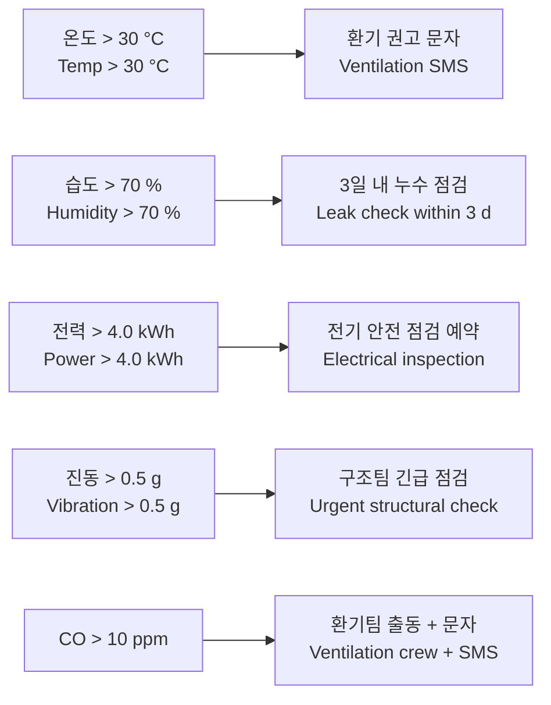

### 5.3 민원 7종 · Seven complaint types

| 유형 · Type | 위험도 · Risk | RPA 자동화 · RPA % |
|---|---|---|
| 누수 · Leak | 중 · Mid | 70 |
| 균열·구조손상 · Crack / structural | 고 · High | 70 |
| 화재·가연성외벽 · Fire / combustible façade | 고 · High | 70 |
| 시설노후 · Ageing facility | 저 · Low | 70 |
| 관리비이의 · Fee dispute | 저 · Low | 100 |
| 계약관련 · Contract | 저 · Low | 100 |
| 기타 · Other | 저 · Low | 70 |

---

## 6. 9개 페이지 · Nine pages

| # | 페이지 · Page | 한국어 기능 | English features |
|---|---|---|---|
| 1 | 📊 통합 대시보드 · Dashboard | KPI 6개, 실시간 알림, 손상 추이 · 민원 분포 · 노후도 · RPA 진행 바 | 6 KPIs, live alerts, damage trend, complaint mix, ageing score, RPA bars |
| 2 | ✈ 비전AI · 드론 · Vision AI & drone | 앱/드론 입력, 샘플 5종 손상 판정, 탐지 결과 표, 세움터·FMS 연동 현황 | App/drone input, 5 sample cases, detection table, Seumteo/FMS link status |
| 3 | 🤖 RPA 행정 · RPA admin | 관리비 고지서(80 %), 계약 만료(100 %), 점검 일정(90 %), 성과 | Billing (80 %), contract expiry (100 %), inspection schedule (90 %), results |
| 4 | 📋 AI 민원 · AI complaints | 필터 4개, 5단계 처리 흐름, 입주민 접수 폼, 처리 통계 | 4 filters, 5-step workflow, resident intake form, stats |
| 5 | 📡 IoT · 디지털 트윈 | 센서 5종 시계열, 임계값 선, 경고 뱃지 | 5 sensor series, threshold lines, warning badges |
| 6 | 🛡 AI 예방 정비 · Preventive | 단지별 위험도 0~99, 기여도 막대, 정비 지시서 자동 생성 | Risk score 0–99 per complex, contribution bars, auto work order |
| 7 | 🏅 마일리지 · Mileage | 세대별 마일리지, 등급 분포, 자체점검 vs 마일리지 | Household mileage, tier mix, self-checks vs mileage |
| 8 | 🔮 Vision 2030 | 고장 · 에너지 · 공실 예측, 사업화 KPI | Failure / energy / vacancy forecast, business KPIs |
| 9 | 🧬 AI 데이터 파이프라인 | 9개 파이프라인 합성 데이터 · 학습 결과 · 시각화, 55개 명세 표 | 9 pipelines: data, training results, charts, 55-spec table |

### 6.1 민원 처리 흐름 · Complaint workflow

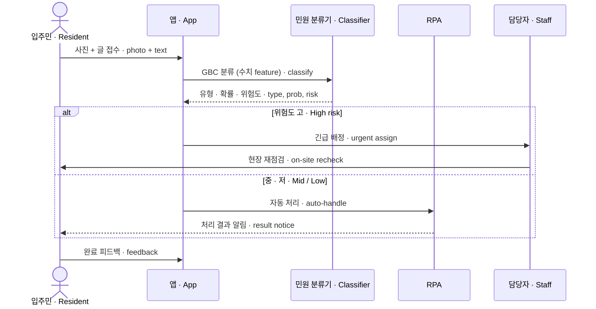

### 6.2 위험도 등급 판정 · Risk grading

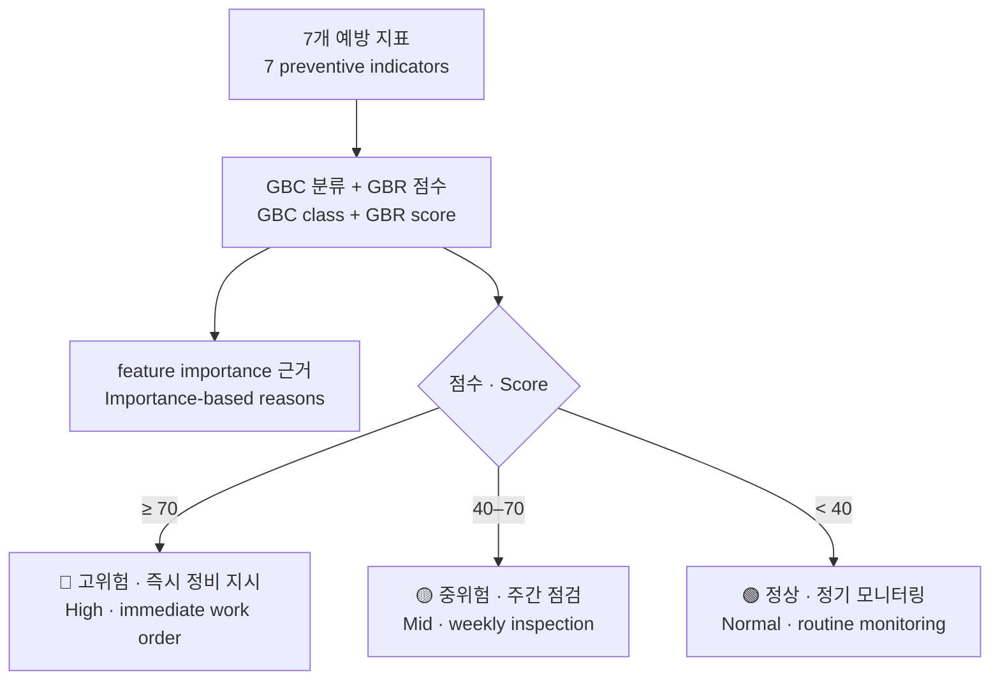

---

## 7. AI 모델 · AI models

### 7.1 9개 파이프라인 — 구현 vs 목표 · Nine pipelines — prototype vs target

| 파이프라인 · Pipeline | 합성 데이터 · Data | 프로토타입 구현 · Prototype | 목표 설계 · Target |
|---|---|---|---|
| 비전 손상 분류 · Vision damage | 500 × 8 feature | RF 7-class | Y-MaskNet (Mask R-CNN) |
| IoT 이상 탐지 · IoT anomaly | 720 h × 5 sensors | IF + RF | LSTM / AutoEncoder |
| 민원 분류 · Complaints | 500 rows + 문장 · text | GBC (수치 feature · numeric) | KoBERT |
| XAI 위험도 · XAI risk | 300 × 7 | GBC + GBR | XGBoost + SHAP |
| 고장 예측 · Failure | 144 (시계열 · monthly) | GBR | LSTM-Attention |
| 에너지 · Energy | 365 d | GBR | RL HVAC 제어 · control |
| 관리비 이상 · Billing anomaly | 1,000 | IF + RF + LR | Ensemble |
| 균열 성장 · Crack growth | 50 × 12 mo | GBR + RF | PINN + FEM |
| 지반침하 · Subsidence | 400 | GBC | SSI 시뮬레이션 · simulation |

| 한국어 | English |
|---|---|
| 성능 수치는 합성 데이터 기준이다. 실데이터 성능을 뜻하지 않는다. 값은 앱 9번 페이지에서 본다. | Scores are on synthetic data and do not imply real-world performance. Values are shown on page 9. |
| 현재는 무작위 train/test 1회 분할이다. 5-fold · walk-forward 검증은 v2.5 브랜치에서 넣는다 (§7.2). | Currently a single random train/test split. 5-fold and walk-forward validation land in the v2.5 branch (§7.2). |

### 7.2 v2.5 검증 흐름 (브랜치 진행 중) · v2.5 validation flow (in progress on branch)

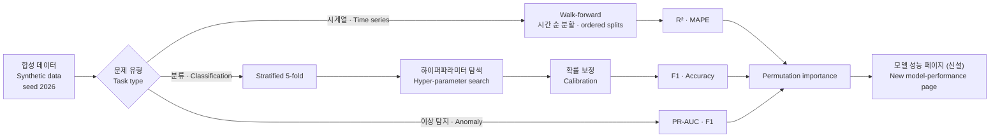

### 7.3 목표 엔진 · Target engines

| 엔진 · Engine | 한국어 | English |
|---|---|---|
| Y-MaskNet | Mask R-CNN + ResNet-101. 드론 4K · 앱 사진에서 균열 영역과 폭(mm)을 낸다. | Mask R-CNN + ResNet-101; outputs crack masks and width (mm) from drone/app images. |
| 오탐 보정 · False-positive filter | FMS 이력 · 설계도 · FEM 해석 세 가지로 교차검증한다. | Cross-checks with FMS history, design drawings and FEM analysis. |
| XAI 위험도 v2.0 | 7개 지표를 묶어 점수를 내고 기여도로 근거를 보인다. 금융 리스크 모형 기법을 옮겼다. | Combines 7 indicators into a score with contribution-based reasons; adapts financial risk-model methods. |
| LLM + RAG | 시설물안전법 · 주택법 · KICT 지침을 검색해 공문서 형식 보고서를 만든다. 3시간 → 36분 목표. | Retrieves facility-safety law, housing law and KICT guidance to draft official-format reports; target 3 h → 36 min. |
| FMS 연동 · FMS link | 20~30년 안전진단 이력으로 노후화 곡선을 만든다. | Builds ageing curves from 20–30 years of inspection history. |
| 세움터 · 지하안전 | 인접 건물 구조 · 지반 정보로 지반-구조물 상호작용을 본다. | Uses neighbouring structure and soil data for soil–structure interaction. |

---

## 8. 55개 데이터셋 파이프라인 · 55-dataset pipeline

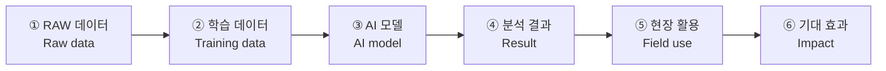

| 카테고리 · Category | 건수 · # | 한국어 | English |
|---|---|---|---|
| 비전AI-이미지 · Vision image | 10 | 균열 · 누수 · 드라이비트 · 박락 | Crack, leak, Dryvit, spalling |
| IoT-센서 · IoT sensor | 6 | 온도 · CO · 진동 · 습도 · 전력 | Temp, CO, vibration, humidity, power |
| IoT-LiDAR | 2 | 3D 점군 분할 · SLAM 변위 | 3D point-cloud segmentation, SLAM displacement |
| 민원 · Complaints | 6 | 문장 분류 · 발생 예측 · 감성 · 사진 · 처리시간 | Text class, volume forecast, sentiment, photo, handling time |
| Digital Twin | 6 | 구조 · 에너지 · 화재 시뮬레이션 | Structure, energy, fire simulation |
| 이상징후 · Anomaly | 5 | 다중 센서 융합 탐지 | Multi-sensor fusion detection |
| 선제탐지 · Early detection | 5 | 균열 · 배관 · 외벽 · 승강기 · 방수 진행 예측 | Crack, pipe, façade, elevator, waterproofing progression |
| RPA | 7 | 관리비 · 계약 · 점검 · 배정 · 보고서 · 고지 · 에너지 | Billing, contract, inspection, assignment, report, notice, energy |
| 예방조치 + 대시보드 · Prevention + dashboard | 8 | 위험도 · 종합 의사결정 · ROI | Risk scoring, decision support, ROI |

---

## 9. RPA 행정 자동화 · RPA automation

| 업무 · Task | 자동화 · Auto % | 전 → 후 · Before → After |
|---|---|---|
| 관리비 고지서 · Fee bills | 80 % | 8 h → 1.5 h |
| 계약 만료 알림 · Contract expiry | 100 % | 60일 내 자동 추출 · auto-extract within 60 d |
| 점검 일정 · Inspection schedule | 90 % | 노후도 우선순위 · ageing-based priority |
| 민원 분류 · Complaint triage | 70 % | 3 d → 1 d |
| 담당자 배정 · Staff assignment | 75 % | 2 h → 5 min |
| **종합 · Overall** | **81.5 %** | |

---

## 10. KPI · 기대효과 · KPIs & expected impact

| KPI | 목표 · Target | 현재 · Current (합성 · synthetic) |
|---|---|---|
| 점검완료율 · Inspection completion | 95 % | 94.2 % |
| AI 탐지 정확도 · Detection accuracy | 93 % | 93.1 % |
| RPA 자동화율 · RPA rate | 80 % | 81.5 % |
| 민원 처리시간 · Complaint time | ≤ 1 d | 1.2 d |
| 고장 감소 · Failure reduction | 30 % | 진행 중 · in progress |
| 에너지 절감 · Energy saving | 15 % | 진행 중 · in progress |
| 공실 감소 · Vacancy reduction | 20 % | 진행 중 · in progress |

| 항목 · Item | 연간 · Annual |
|---|---|
| 관리비 업무 효율화 · Billing efficiency | 1,350만원 · KRW 13.5 M |
| 에너지 비용 · Energy cost | 1,800만원 · KRW 18.0 M |
| 조기 탐지 보수비 · Early-repair saving | 4,200만원 · KRW 42.0 M |
| **총 절감 · Total** | **7,350만원 · KRW 73.5 M** |
| **ROI · 회수 기간 · Payback** | **340 % · 8개월 · 8 months** |

---

## 11. 실행 · 배포 · Run & deploy

```bash
pip install -r requirements.txt
python main.py            # 또는 · or: streamlit run app.py
# http://localhost:8501
```


| 설정 · Setting | 값 · Value | 한국어 | English |
|---|---|---|---|
| region | singapore | 한국 최근접 리전 | Closest region to Korea |
| plan | free | 월 750시간 | 750 h / month |
| `server.maxUploadSize` | 50 | 업로드 최대 50 MB | Max upload 50 MB |
| `server.enableXsrfProtection` | true | XSRF 방어 | XSRF protection |

---

## 12. 컨소시엄 · Consortium

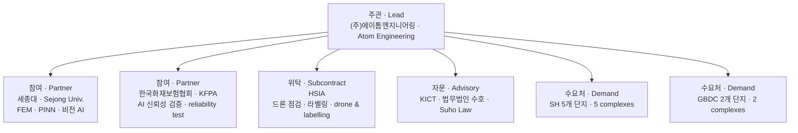

---

## 13. 로드맵 · 버전 · Roadmap & versions

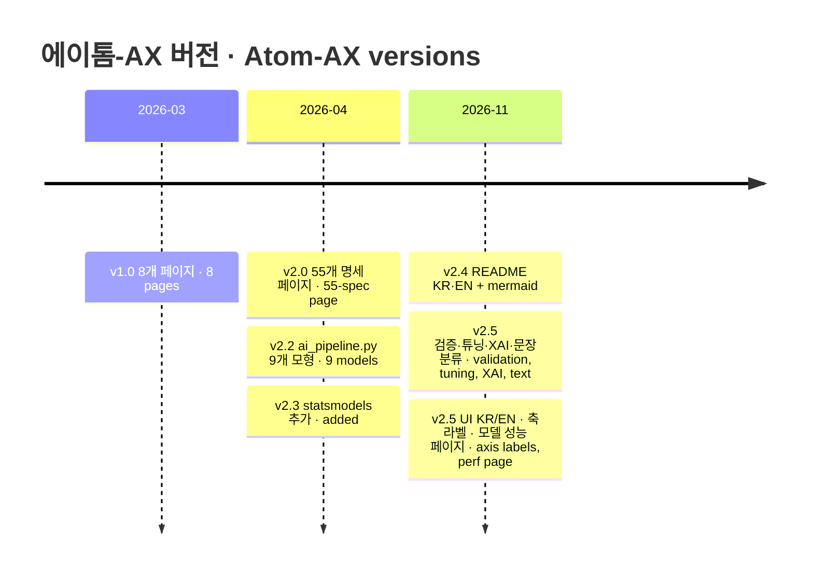

| 버전 · Ver | 날짜 · Date | 한국어 | English |
|---|---|---|---|
| v2.5 | 2026-11 (브랜치 · branch) | 검증 체계(5-fold · walk-forward), HGB 튜닝 · 보정, permutation importance, TF-IDF 민원 분류, UI KR/EN · 축 라벨 · 10번 모델 성능 페이지 | Validation (5-fold, walk-forward), HGB tuning & calibration, permutation importance, TF-IDF complaints, UI KR/EN, axis labels, page 10 |
| v2.4 | 2026-11-19 | README 를 KR·EN 나란히 + mermaid 다이어그램으로 재작성. 구현 vs 목표 구분 | README rewritten side-by-side KR/EN with mermaid; prototype vs target split |
| v2.3 | 2026-04-15 | `statsmodels` 추가, Render `ModuleNotFoundError` 해결 | Added `statsmodels`, fixed Render `ModuleNotFoundError` |
| v2.2 | 2026-04-13 | `ai_pipeline.py` 신설, 9번 페이지 교체 | Added `ai_pipeline.py`, rebuilt page 9 |
| v2.1 | 2026-04-12 | README 기술 보고서 재작성, 55건 반영 | README report rewrite, 55 specs |
| v2.0 | 2026-04 | 9번 페이지 · Render Blueprint · 버전 고정 | Page 9, Render blueprint, pinned versions |
| v1.0 | 2026-03 | 초기 릴리스 8개 페이지 | Initial release, 8 pages |

---

> 국토교통부 AX-SPRINT 과제 프로토타입 (2026) · MOLIT AX-SPRINT prototype (2026)
